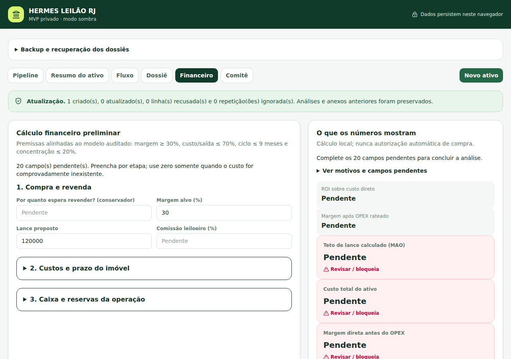

# Demonstração e estudo de caso

[README](../../README.md) · [English overview](../../README_EN.md)

## Problema

Triar oportunidades e organizar premissas e dossiês antes da revisão humana.

## Decisão de engenharia e contribuição do projeto

Conferir a prévia antes de importar e manter valores desconhecidos como pendentes; cálculo local nunca autoriza compra.

A implementação e a avaliação estão no repositório; bibliotecas e motores de terceiros conservam autoria e condições próprias. Este estudo descreve o estágio observado, sem atribuir validação comercial a uma demonstração.

## Entrada → operação → resultado

Siga a sequência de [RECORDING.md](RECORDING.md). A imagem abaixo e o vídeo mostram a interface real, executada localmente com dados fictícios.

[▶ Assistir ao vídeo de aproximadamente 44 segundos](demo.mp4)

Vídeo sem narração; interface em português. Esta é uma demonstração selecionada, não uma homologação E2E completa.

## Resultado verificado

33 testes selecionados aprovados. A importação do apartamento fictício criou um registro; o financeiro preservou 20 campos pendentes e bloqueou a conclusão.

- Comando: `npm run test:unit`.
- Código executado: [`5a03c932e8cf`](https://github.com/ofelipepeixoto/hermes-leilao-rj/tree/5a03c932e8cf9798790b33e710af2239f8cb24c0).
- Ambiente: Linux, Python 3.12.14 para PDF; Node 24.19.0 para aplicações web.
- Reprodução: 11/10/2026 UTC, 10/10/2026 em São Paulo.

## Limites e aprendizado

Não é suíte completa nem aprovação de investimento. Não houve consulta real a catálogos, lances, pagamentos ou assinatura; persistência local sem dupla aprovação autenticada.

A diferença entre dados pendentes, evidência sintética e resultado validado continua visível. Não foram medidos produtividade, adoção, receita ou satisfação de clientes nesta rodada. Contagens de testes não substituem essas métricas.

## Reproduzir

Use os comandos do [README](../../README.md), apenas fixtures fictícias e a sequência de [RECORDING.md](RECORDING.md). O [guia em inglês](../../README_EN.md) explica entrada, operação, resultado e limites para visitantes internacionais. Não grave dados privados, credenciais ou documentos de clientes.
